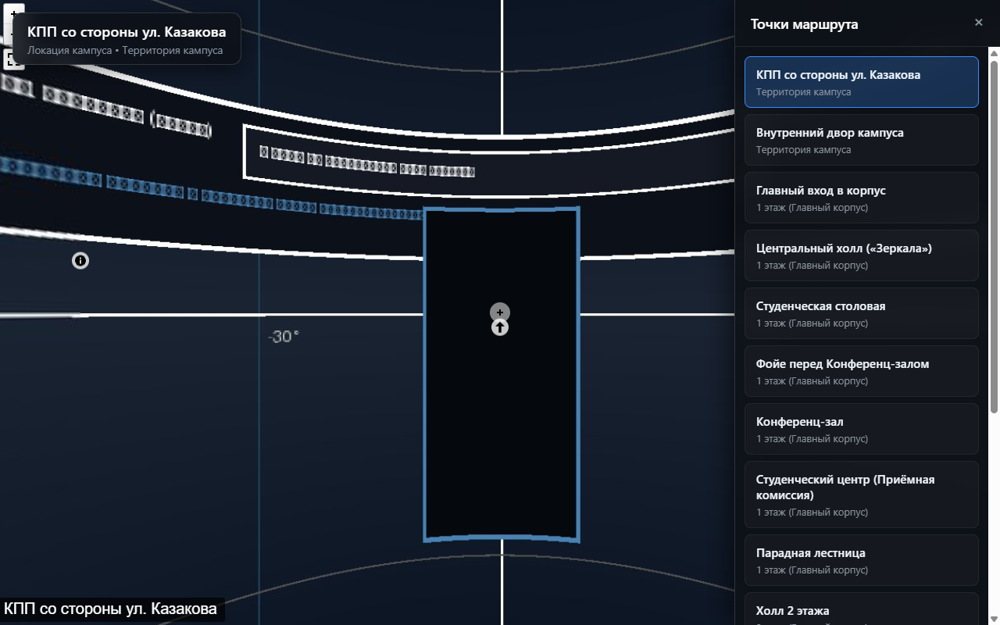

# Виртуальная экскурсия по МИИГАиК

## О проекте

«Виртуальная экскурсия по МИИГАиК» — веб-приложение для интерактивного знакомства с главным корпусом и территорией Московского государственного университета геодезии и картографии.



Пользователь сможет перемещаться между сферическими панорамами 360°, изучать помещения университета, просматривать информацию об объектах и определять своё местоположение на интерактивном плане или карте.

## Актуальность

Абитуриентам и гостям важно заранее познакомиться с университетом, а первокурсникам — понять расположение помещений и ориентиров перед очным посещением. Виртуальная экскурсия позволяет представить пространственную организацию здания дистанционно. Применимость таких веб-туров для университетской навигации рассматривается в исследовании Salah и соавторов ([2023](https://doi.org/10.18576/isl/120906)). В работе Samala и соавторов ([2024](https://doi.org/10.3991/ijoe.v20i01.44339), с. 118) описаны выбор локации из списка, переходы между панорамами и информационные окна. Исследование Figueroa и соавторов ([2020](https://doi.org/10.32664/ijitgeb.v2i1.60), с. 5) показывает необходимость отдельно оценивать удобство такого интерфейса.

В [анализе экскурсии МИИГАиК_360](docs/analysis_existing_tour.md) отмечены полезные возможности существующего тура (детализированные панорамы, планы этажей), а также проблемы понятности названий и переходов, мобильного интерфейса и охвата территории. Эти наблюдения служат основанием для проектирования. Актуальность проекта состоит в адаптации панорамной экскурсии к маршрутам и информационным потребностям посетителей именно МИИГАиК. Подборка исследований приведена в [паспорте источников](docs/sources_passport.md).

## Цель проекта

Разработка веб-приложения для дистанционного знакомства абитуриентов, гостей и первокурсников с главным корпусом и территорией МИИГАиК.

## Основные задачи

- Создать систему просмотра сферических панорам.
- Реализовать переходы между точками виртуальной экскурсии.
- Добавить информационные метки с описаниями объектов.
- Разработать интерактивные планы этажей и карту территории.
- Обеспечить корректную работу на компьютерах и смартфонах.
- Оптимизировать загрузку панорам.
- Опубликовать приложение на GitHub Pages.

## Технологический стек

### Веб-приложение

- HTML5, CSS3;
- TypeScript 5.9.3;
- Node.js 24 LTS;
- Vite 6.4.6;
- Pannellum 2.5.7;
- Leaflet 1.9.4 (планируется, пока не подключён);
- JSON.

Для реализации клиентской части выбран TypeScript. Версии установленных зависимостей указаны по `package-lock.json`. Обоснование сохранения Pannellum — в [сравнительном анализе библиотек](docs/criteria_passport.md).

### Обработка изображений

- Hugin — сшивка панорам;
- GIMP — обработка изображений;
- JPEG и WebP — форматы изображений;
- Python, Pillow, NumPy и Hugin nona — подготовка мультиразрешённых панорам.

### Инфраструктура

- Git и GitHub;
- GitHub Projects;
- GitHub Actions;
- GitHub Pages;
- Lighthouse.

## Структура проекта

```text
├── docs/                 # Проектная документация (требования, анализ, бэклог, UML)
│   ├── data/             # Схемы данных (JSON Schema для scenes.json)
│   ├── sprints/          # Планы и отчеты по спринтам
│   ├── uml/              # Исходники PlantUML и изображения диаграмм
│   └── diagrams/         # Диаграмма вариантов использования
├── experiments/          # Отдельные прототипы интерфейсов
├── public/               # Статические ресурсы
│   ├── data/             # Конфигурация виртуального тура (scenes.json)
│   ├── floorplans/       # Каталог для планируемых схем и планов этажей
│   └── panoramas/        # Нарезанные кубические тайлы панорам
├── scripts/              # Служебные скрипты (нарезка тайлов, пакетная обработка)
├── src/                  # Исходный код веб-приложения (TypeScript, CSS, компоненты)
├── .gitignore            # Правила исключения временных файлов и тяжелых исходников
└── README.md             # Описание проекта
```

> **Примечание по исходным материалам:** Несжатые исходные фотографии планируется хранить отдельно от Git. В `public/panoramas/` размещаются оптимизированные тайлы; сейчас используются тестовые изображения.

## Планируемый функционал

### Минимально жизнеспособная версия (MVP)

- Не менее 15 точек виртуальной экскурсии.
- Просмотр панорам 360°.
- Переходы между сценами.
- Информационные метки.
- Интерактивный план здания и карта территории.
- Адаптивный интерфейс.
- Публикация на GitHub Pages.

## Как запустить

Требуется Node.js 22 или 24 LTS, npm и современный браузер с поддержкой WebGL.

```bash
git clone https://github.com/Ely1266/miigaik-virtual-tour.git
cd miigaik-virtual-tour
npm ci
npm run dev
```

Откройте локальный адрес, указанный Vite (обычно `http://localhost:5173/`). Для сборки используйте `npm run build`, для просмотра сборки — `npm run preview`.

## Организация работы

Задачи ведутся в [GitHub Issues](https://github.com/Ely1266/miigaik-virtual-tour/issues) и на [доске проекта](https://github.com/users/Ely1266/projects/1). [Бэклог](docs/backlog.md) определяет пользовательские истории и критерии приёмки, [план спринтов](docs/sprints/plan.md) — порядок разработки. Правила работы с ветками, коммитами и проверками описаны в [CONTRIBUTING.md](CONTRIBUTING.md).

## Состав команды

**Максим Вячеславович** — разработка веб-приложения, проектирование интерфейса, подготовка контента, обработка панорам, тестирование и документация.

Проект выполняется индивидуально.

GitHub: [Ely1266](https://github.com/Ely1266)

## Существующие разработки

При проектировании учитывается виртуальный тур «МИИГАиК_360», выполненный студентом 4-го курса ФКГ Вячеславом Бочкарёвым.

Существующий тур: https://kartfak.ru/development/miigaik_360/

Разрабатываемое приложение представляет собой самостоятельную реализацию с открытым исходным кодом и внешней JSON-конфигурацией сцен.

## Статус проекта

Прототип в разработке (версия 0.1.0). В конфигурации — 15 сцен с тестовыми панорамами, переходами и информационными метками. Код предусматривает список локаций и отображение названия сцены и этажа. Интерактивные планы, поиск аудиторий, натурная съёмка, проверка на целевых устройствах и публикация остаются в плане работ.

## Лицензия

Собственный программный код проекта распространяется по [MIT](LICENSE). Сторонние компоненты сохраняют свои лицензии; уведомления и полный текст лицензии Pannellum приведены в [THIRD_PARTY_NOTICES.md](THIRD_PARTY_NOTICES.md). Условия распространения медиаматериалов, включая запланированные реальные фотографии и планы этажей, требуют отдельного подтверждения; MIT на них автоматически не распространяется. Условия распространения компонентов приведены в [лицензионном паспорте](docs/licenses.md).
