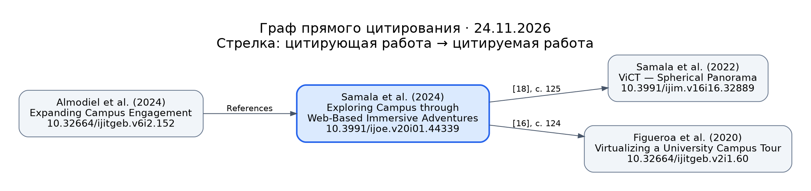

# Паспорт источников проекта «Виртуальная экскурсия по МИИГАиК»

**Тема:** веб-экскурсия по главному корпусу и территории университета на основе панорам 360°, с переходами между сценами и информационными метками.

**Дата библиографической сверки:** 24.11.2026.

## 1. Исходный запрос и ответ ИИ

Номера в предварительной подборке относятся к поисковому ответу; ссылки в квадратных скобках в следующих разделах — к библиографии в разделе 7.

### Поисковый запрос

> Задача: подобрать до 9 публикаций для обзора проекта «Виртуальная экскурсия по МИИГАиК». Тема: веб-экскурсии по кампусам, панорамные изображения 360°, навигация, UX и веб-просмотрщики. Используй поиск в интернете, а не память; если поиск недоступен, сообщи и остановись. Включай только публикации с открытой в ходе этого исследования страницей журнала, издателя или научного каталога. Для каждой записи дай точный заголовок, авторов, издание, год, том, выпуск, страницы, DOI, прямой URL и одно предложение о релевантности; отсутствующие метаданные пометь «НЕ УКАЗАНО». Не заполняй список выдумками: если нашлось меньше девяти, остановись со словами «БОЛЬШЕ НЕ НАЙДЕНО». Похожие, но не подходящие публикации отдели. После таблицы перечисли фактически использованные поисковые запросы.

### Предварительная подборка публикаций

| № | Авторы | Заглавие | Издание, год, том, номер, страницы | DOI | Прямая страница издателя / журнала | Отношение к теме |
|---|---|---|---|---|---|---|
| 1 | Roberto B. Figueroa, Jr.; Gibran Alejandro Garcia Mendoza; Jennifer Christine Clasara Fajardo; Siaw Eng Tan; Eiman Yassin; Teo Hui Thian | Virtualizing a University Campus Tour: A Pilot Study on its Usability and User Experience, and Perception | International Journal in Information Technology in Governance, Education and Business, 2020, 2(1), 1–8 | 10.32664/ijitgeb.v2i1.60 | https://ijitgeb.org/ijitgeb/article/view/60 | Исследован фото-тур университета и пользовательское восприятие. |
| 2 | Aznoora Osman; Nur Izlin Iskak; Nadia Abdul Wahab; Norfiza Ibrahim | Interactive Virtual Campus Tour using Panoramic Video: A Heuristic Evaluation | Journal of Computing Research and Innovation, 2020, 5(4), 1–7 | 10.24191/jcrinn.v5i4.160 | https://jcrinn.com/index.php/jcrinn/article/view/160 | Рассмотрена экспертная оценка интерфейса кампусного тура. |
| 3 | Agariadne Dwinggo Samala; Fadhli Ranuharja; Bayu Ramadhani Fajri; Yose Indarta; Winda Agustiarmi | ViCT—Virtual Campus Tour Environment with Spherical Panorama: A Preliminary Exploration | International Journal of Interactive Mobile Technologies, 2022, 16(16), 205–225 | 10.3991/ijim.v16i16.32889 | https://online-journals.org/index.php/i-jim/article/view/32889 | Описан веб-тур на сферических панорамах. |
| 4 | Agariadne Dwinggo Samala; Marina Ricci; Christian Jonathan Angel Rueda; Ljubisa Bojic; Fadhli Ranuharja; Winda Agustiarmi | Exploring Campus through Web-Based Immersive Adventures Using Virtual Reality Photography: A Low-Cost Virtual Tour Experience | International Journal of Online and Biomedical Engineering, 2024, 20(1), 104–127 | 10.3991/ijoe.v20i01.44339 | https://iris.poliba.it/handle/11589/264700 | Рассмотрена веб-экскурсия с VR-фотографией и тестированием. |
| 5 | Lanto Ningrayati Amali; Muhammad Rifai Katili; Alif Perdana Sugeha | Development of virtual tour reality using 360-degree panoramic images and Leaflet JavaScript | Indonesian Journal of Electrical Engineering and Computer Science, 2024, 35(1), 655–664 | 10.11591/ijeecs.v35.i1.pp655-664 | https://ijeecs.iaescore.com/index.php/IJEECS/article/view/35879 | Описана интеграция панорам и карты Leaflet для кампуса. |
| 6 | Achmad Choiron; Rusdi Hamidan | UX Analysis of the Virtual Tour 360 Application at Universitas Dr. Soetomo Campus | Journal of Applied Informatics and Computing, 2025, 9(1), 73–78 | 10.30871/jaic.v9i1.8813 | https://jurnal.polibatam.ac.id/index.php/JAIC/article/view/8813 | Исследованы удобство переходов и мобильный интерфейс. |
| 7 | Myra Collado Almodiel; Anna Ma. Elizabeth F. Cañas-Llamas; Marinela S. Hernandez; Anna Mhari C. Duria; Zyrene Edrei M. Villanueva | Expanding Campus Engagement: A Study on the User Acceptance of a Virtual Reality-Enhanced Campus Tour in an Open University | International Journal in Information Technology in Governance, Education and Business, 2024, 6(2), НЕ УКАЗАНО | 10.32664/ijitgeb.v6i2.152 | https://ijitgeb.org/ijitgeb/article/view/152 | Изучено принятие VR-экскурсии сотрудниками и студентами. |
| 8 | Dorian Baltzer; Alexander Naumann; Stephan Rosenberg; Jan-Henrik Haunert | Graph Construction and Interactive Visualization for Virtual Tours Based on Redundant Panoramic Image Collections | Journal of Geovisualization and Spatial Analysis, 2025, 9, article 26 | 10.1007/s41651-025-00228-1 | https://link.springer.com/article/10.1007/s41651-025-00228-1 | Исследовано построение навигационного графа между панорамами; есть исправление от 28.05.2025. |
| 9 | Matthew A. Petroff | Pannellum: a lightweight web-based panorama viewer | Journal of Open Source Software, 2019, 4(40), article 1628 | 10.21105/joss.01628 | https://joss.theoj.org/papers/10.21105/joss.01628 | Описан веб-просмотрщик, подключённый в проекте. |

**Близкое, но не по теме:** отдельные находки не внесены в этот список; такие результаты не выдаются за релевантные исследования.

**Поисковые запросы, использованные для предварительного поиска:**

- `peer reviewed university virtual campus tour 360 degree usability visitor study virtual tour higher education journal doi`
- `360 degree virtual tour university campus user experience study virtual reality education journal doi`
- `virtual tour panoramic interface navigation spatial cognition research peer reviewed virtual tours doi`

## 2. Журнал проверки исходного ответа

Девять записей сопоставлены со страницами журналов, издательскими PDF и научными каталогами. DOI приведены в разделе 7 и в предварительной подборке.

| № | Прямая страница и подтверждение метаданных | Результат сверки |
|---|---|---|
| 1 | [Журнал](https://ijitgeb.org/ijitgeb/article/view/60), [PDF](https://ijitgeb.org/ijitgeb/article/download/60/42): 6 авторов, заглавие, 2020, 2(1), с. 1–8, DOI | Подтверждена |
| 2 | [Журнал](https://jcrinn.com/index.php/jcrinn/article/view/160), [PDF](https://jcrinn.com/index.php/jcrinn/article/download/160/125/1515): 4 автора, заглавие, 2020, 5(4), с. 1–7, DOI | Подтверждена |
| 3 | [Журнал](https://online-journals.org/index.php/i-jim/article/view/32889): 5 авторов, заглавие, 2022, 16(16), с. 205–225, DOI | Подтверждена |
| 4 | [Журнал](https://online-journals.org/index.php/i-joe/article/view/44339), [PDF](https://online-journals.org/index.php/i-joe/article/download/44339/14483): 6 авторов, заглавие, 2024, 20(1), с. 104–127, DOI | Подтверждена; добавлен URL издателя |
| 5 | [Журнал](https://ijeecs.iaescore.com/index.php/IJEECS/article/view/35879): 3 автора, заглавие, 35(1), DOI содержит диапазон 655–664; год и страницы требуют прямой сверки с PDF/выпуском | Существование подтверждено; уточнить страницы по PDF |
| 6 | [DOAJ](https://doaj.org/article/1041802e0a5a408d836c1162f728e76f), [издательский PDF](https://jurnal.polibatam.ac.id/index.php/JAIC/article/download/8813/2592/27954): 2 автора, заглавие, 2025, 9(1), с. 73–78, DOI в DOAJ; карточка издателя не открылась | Подтверждена по PDF и каталогу |
| 7 | [Журнал](https://ijitgeb.org/ijitgeb/article/view/152): 5 авторов, заглавие, 2024, 6(2), DOI; диапазон страниц не отображается, PDF не удалось открыть | Существует, запись неполная; оставлена для графа, пока не включена в список |
| 8 | [Springer](https://link.springer.com/article/10.1007/s41651-025-00228-1): 4 автора, заглавие, 2025, т. 9, статья 26, DOI. [Исправление](https://doi.org/10.1007/s41651-025-00229-0) касается финансирования, не результатов | Подтверждена; учтено исправление |
| 9 | [JOSS](https://joss.theoj.org/papers/10.21105/joss.01628): автор, заглавие, 2019, 4(40), статья 1628, DOI, публичные рецензенты | Подтверждена |

Найдены все девять публикаций; у семи сверены все перечисленные поля, у двух (№ 5, 7) не подтверждены отдельные метаданные. Статус ретракции отдельно не исследовался.

Рецензирование: [IJITGEB — политика](https://ijitgeb.org/ijitgeb/navigationMenu/view/publication-ethics), [JCRINN — политика доступна через меню журнала](https://jcrinn.com/index.php/jcrinn/article/view/160), [iJOE — политика](https://online-journals.org/index.php/i-joe/ethics), [IJEECS — описание журнала](https://ijeecs.iaescore.com/index.php/IJEECS/index), [JOSS — публичное рецензирование конкретной статьи](https://joss.theoj.org/papers/10.21105/joss.01628), [JOINCS — ссылка Peer Review Process в меню](https://joincs.umsida.ac.id/index.php/joincs/article/view/1627). Принадлежность к ВАК, Белому списку и ядру РИНЦ не установлена и не заявляется.

## 3. Дополнительный поиск по смыслу и ключевым словам

Тематическое описание для поиска:

> Абитуриентам, гостям и первокурсникам МИИГАиК требуется возможность дистанционно познакомиться с главным корпусом и территорией, заранее понять расположение помещений и получить справочную информацию. В проекте рассматривается веб-экскурсия на сферических панорамах с переходами, информационными метками и планируемыми картами этажей. Для обоснования решения необходимо изучить университетские виртуальные туры, удобство мобильной навигации, пространственное ориентирование и способы загрузки панорамных изображений.

Дополнительные публикации найдены веб-поиском и сопоставлены с издательскими страницами.

Ключевые слова из уже найденных работ: `virtual campus tour`, `spherical panorama`, `user experience`, `mobile accessibility`, `virtual tours`, `linear exploration`. Использованные дополнительные запросы включали `"Using virtual tours as a university campus guide" Salah`, `"Enhanced Visitor Experience Through Campus Virtual Tour" 012067 IOP Rohizan`, `Google Scholar virtual campus tour panoramic images web campus tour Salah Insa Iglesias`; дополнительно открыты издательские карточки Insa-Iglesias и Akbar.

| № в списке | Публикация | Что даёт проекту |
|---|---|---|
| 9 | [Insa-Iglesias et al., 2020](https://www.scitepress.org/Papers/2020/101767/) | Недорогой веб-тур на Marzipano, доступность и оценка университетского сценария |
| 10 | [Salah et al., 2023](https://www.naturalspublishing.com/Article.asp?ArtcID=27576) | Поиск конкретных помещений и обозначений на публичном сайте без специального VR-оборудования |
| 11 | [Akbar et al., 2024](https://joincs.umsida.ac.id/index.php/joincs/article/view/1627) | Сравнение свободной и последовательной навигации по панорамам; измерение времени и знания ориентиров |

## 4. Граф цитирования

Ключевая статья — Samala et al. (2024), [4]. Граф отражает подтверждённые связи по спискам литературы; стрелки направлены от цитирующей работы к цитируемой.

- Назад: [4] ссылается на Figueroa et al. (2020), [1], позиция 16, с. 124; и Samala et al. (2022), [3], позиция 18, с. 125. В [полном тексте ключевой статьи](https://online-journals.org/index.php/i-joe/article/download/44339/14483) на с. 106–107 описана связь с предшествующим исследованием ViCT.
- Вперёд: [Almodiel et al. (2024)](https://ijitgeb.org/ijitgeb/article/view/152) приводит DOI [4] в References и исследует принятие виртуального тура сотрудниками и студентами открытого университета. Эта работа существует; диапазон страниц пока не подтверждён, поэтому она не включена в итоговый список. Прямое цитирование подтверждено по странице журнала, но полное содержание работы ещё следует прочитать.

## 5. Программные ресурсы

| № | Программа и создатель | Версия | Лицензия и первоисточник | Роль |
|---|---|---|---|---|
| 12 | Pannellum, Matthew Petroff | 2.5.7 | MIT; [официальная загрузка](https://pannellum.org/download/), [COPYING](https://github.com/mpetroff/pannellum/blob/master/COPYING); версия также зафиксирована в `package.json`, проверен файл лицензии пакета | Фактически используемая библиотека панорам | 
| 13 | Leaflet, Volodymyr Agafonkin и участники | 1.9.4 | BSD-2-Clause; [релизы](https://github.com/Leaflet/Leaflet/releases), [LICENSE](https://github.com/Leaflet/Leaflet/blob/main/LICENSE) | Планируемая библиотека карт |

Лицензии сопоставлены с файлами первичных репозиториев; для Pannellum дополнительно проверен текст лицензии установленной версии.

## 6. Три утверждения из полных текстов

Все три утверждения извлечены из основных разделов открытых PDF, не из аннотаций; страницы сверены по напечатанной нумерации и снимкам страниц.

| Источник и страница | Утверждение | Применимость и ограничение |
|---|---|---|
| [1], с. 5, *Data-related procedures and results*, [PDF](https://ijitgeb.org/ijitgeb/article/download/60/42#page=5) | По 130 ответам средняя оценка удобства тура составила 67,29; участники, ощущавшие пространственное присутствие, дали в среднем на 9 единиц более высокую оценку удобства (p < 0,01). | Обосновывает необходимость измерять UX, но не доказывает причинность или удобство тура МИИГАиК. |
| [2], с. 4, *Heuristic evaluation*, [PDF](https://jcrinn.com/index.php/jcrinn/article/download/160/125/1515#page=4) | Пять преподавателей с опытом в информатике оценили интерфейс кампусного тура по критериям удобства с пятибалльной шкалой Лайкерта. | Пример методики экспертного тестирования, не результаты нашего приложения. |
| [4], с. 118, § 4.1, [PDF](https://online-journals.org/index.php/i-joe/article/download/44339/14483#page=15) | В VICT предусмотрены выбор локации из списка, переходы через метки на панорамах и информационные окна с мультимедийным содержимым. | Подтверждает существование аналога с похожими функциями; не подтверждает превосходство нашего интерфейса. |

## 7. Список источников

Библиография оформлена по ГОСТ Р 7.0.100–2018: 10 журнальных статей, одна публикация в трудах конференции и два программных ресурса. Диапазон страниц № 5 указан по DOI и требует сверки с полным текстом.

1. Virtualizing a University Campus Tour: A Pilot Study on its Usability and User Experience, and Perception / R. B. Figueroa Jr. [et al.] // International Journal in Information Technology in Governance, Education and Business. — 2020. — Vol. 2, no. 1. — P. 1–8. — DOI: [10.32664/ijitgeb.v2i1.60](https://doi.org/10.32664/ijitgeb.v2i1.60).
2. Interactive Virtual Campus Tour using Panoramic Video: A Heuristic Evaluation / A. Osman, N. I. Iskak, N. Abdul Wahab, N. Ibrahim // Journal of Computing Research and Innovation. — 2020. — Vol. 5, no. 4. — P. 1–7. — DOI: [10.24191/jcrinn.v5i4.160](https://doi.org/10.24191/jcrinn.v5i4.160).
3. ViCT—Virtual Campus Tour Environment with Spherical Panorama: A Preliminary Exploration / A. D. Samala [et al.] // International Journal of Interactive Mobile Technologies. — 2022. — Vol. 16, no. 16. — P. 205–225. — DOI: [10.3991/ijim.v16i16.32889](https://doi.org/10.3991/ijim.v16i16.32889).
4. Exploring Campus through Web-Based Immersive Adventures Using Virtual Reality Photography: A Low-Cost Virtual Tour Experience / A. D. Samala [et al.] // International Journal of Online and Biomedical Engineering. — 2024. — Vol. 20, no. 1. — P. 104–127. — DOI: [10.3991/ijoe.v20i01.44339](https://doi.org/10.3991/ijoe.v20i01.44339).
5. Amali, L. N. Development of virtual tour reality using 360-degree panoramic images and Leaflet JavaScript / L. N. Amali, M. R. Katili, A. P. Sugeha // Indonesian Journal of Electrical Engineering and Computer Science. — 2024. — Vol. 35, no. 1. — P. 655–664. — DOI: [10.11591/ijeecs.v35.i1.pp655-664](https://doi.org/10.11591/ijeecs.v35.i1.pp655-664).
6. Choiron, A. UX Analysis of the Virtual Tour 360 Application at Universitas Dr. Soetomo Campus / A. Choiron, R. Hamidan // Journal of Applied Informatics and Computing. — 2025. — Vol. 9, no. 1. — P. 73–78. — DOI: [10.30871/jaic.v9i1.8813](https://doi.org/10.30871/jaic.v9i1.8813).
7. Graph Construction and Interactive Visualization for Virtual Tours Based on Redundant Panoramic Image Collections / D. Baltzer, A. Naumann, S. Rosenberg, J.-H. Haunert // Journal of Geovisualization and Spatial Analysis. — 2025. — Vol. 9. — Art. 26. — DOI: [10.1007/s41651-025-00228-1](https://doi.org/10.1007/s41651-025-00228-1).
8. Petroff, M. A. Pannellum: a lightweight web-based panorama viewer / M. A. Petroff // Journal of Open Source Software. — 2019. — Vol. 4, no. 40. — Art. 1628. — DOI: [10.21105/joss.01628](https://doi.org/10.21105/joss.01628).
9. Insa-Iglesias, M. Rapid Development of a Low-cost Web-based 360 Virtual Tour / M. Insa-Iglesias, M. Jenkins, G. Morison // Proceedings of the 16th International Conference on Web Information Systems and Technologies (WEBIST). — SciTePress, 2020. — Vol. 1. — P. 315–322. — DOI: [10.5220/0010176703150322](https://doi.org/10.5220/0010176703150322).
10. Using Virtual Tours as a University Campus Guide: Al-Zaytoonah University Case Study / M. Salah [et al.] // Information Sciences Letters. — 2023. — Vol. 12, no. 9. — P. 2961–2970. — DOI: [10.18576/isl/120906](https://doi.org/10.18576/isl/120906).
11. Performance Analysis of Virtual Tour Navigation Guides for Landmark Recognition: Analisis Performa Panduan Navigasi Pada Pengenalan Ruang Berbasis Virtual Tour / M. A. Akbar [et al.] // JOINCS (Journal of Informatics, Network, and Computer Science). — 2024. — Vol. 7, no. 1. — P. 9–15. — DOI: [10.21070/joincs.v7i1.1627](https://doi.org/10.21070/joincs.v7i1.1627).
12. Petroff, M. Pannellum : программное обеспечение / M. Petroff. — Версия 2.5.7. — URL: https://pannellum.org/download/ (дата обращения: 24.11.2026). — Лицензия MIT.
13. Leaflet : программное обеспечение / V. Agafonkin [et al.]. — Версия 1.9.4. — URL: https://github.com/Leaflet/Leaflet/releases (дата обращения: 24.11.2026). — Лицензия BSD-2-Clause.

**Локальный аналог:** [МИИГАиК_360](https://kartfak.ru/development/miigaik_360/) — см. [анализ существующей экскурсии](analysis_existing_tour.md). Сведения об интерфейсе приведены по наблюдениям, зафиксированным в этом анализе; дата публикации не установлена.

## 8. Вывод для последующего обзора аналогов

Фотографические экскурсии уже применяются для дистанционного ознакомления с университетом, однако результаты исследования International Christian University указывают на необходимость отдельной оценки удобства [1, с. 5]. В проекте VICT реализованы переходы по панорамам, список локаций и информационные окна, а в исследовании Universitas Negeri Gorontalo — сочетание панорам с интерактивной картой [4, с. 118; 5]. Веб-тур Al-Zaytoonah University направлен именно на поиск помещений, а не только на демонстрацию кампуса [10]. Для проектирования навигации также полезно исследование, сравнивающее линейные маршруты со свободным перемещением по панорамным сценам [11]. Существуют недорогие веб-подходы на Marzipano и Pannellum, поэтому разработка отдельного просмотрщика с нуля не является необходимой [8; 9]. В рассмотренных публикациях не найдено готового решения, которое можно без адаптации применить к конкретным помещениям МИИГАиК; это ограничение подборки, а не доказательство отсутствия других разработок [4; 5; 10].

### Сопоставление с исходным проектом (по описаниям опубликованных исследований)

| Решение | Что прямо описано в источнике | Что учитывать в МИИГАиК |
|---|---|---|
| МИИГАиК_360 | По [анализу существующей экскурсии](analysis_existing_tour.md): панорамы и мини-карта, недостаточно ясные подписи переходов | Уточнить названия сцен и назначение меток |
| VICT [4] | Список локаций, метки переходов, окна информации | Сопоставить понятность переходов и содержание меток |
| UNG [5] | Панорамы, карта Leaflet, горячие точки | Интеграция карты предусмотрена планом разработки |
| ZUJ [10] | Публичный сайт, обозначения зданий и помещений | Проверить, можно ли найти нужную аудиторию до очного визита |
| GCU [9] | Marzipano, веб-тур и доступность | Сопоставить с выбранным Pannellum; не менять библиотеку без оснований |

Сравнение ограничено сведениями из публикаций и документацией исходного репозитория. Оно не является измерением скорости, удобства или сравнительным испытанием работающих приложений.
